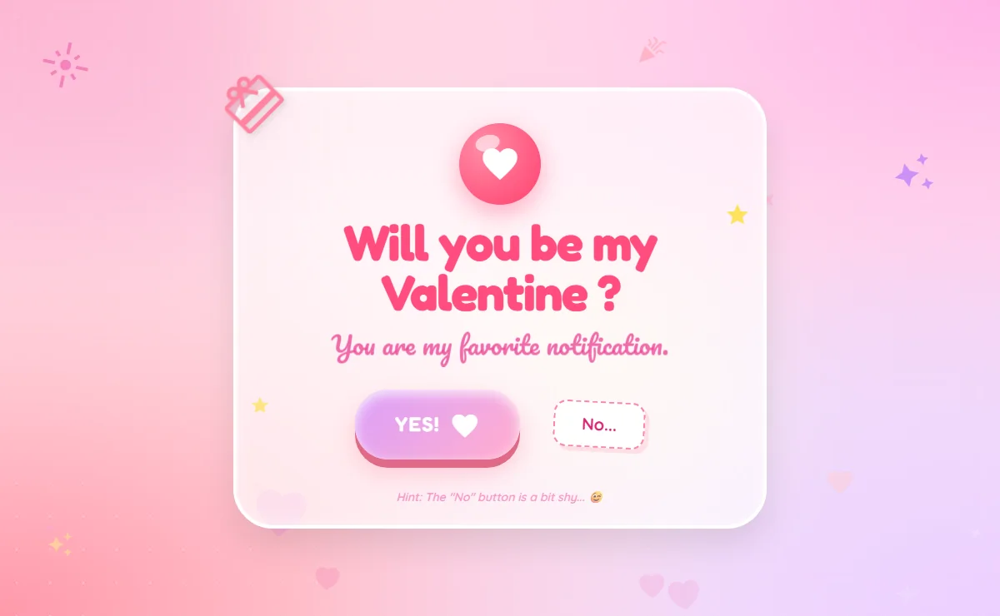
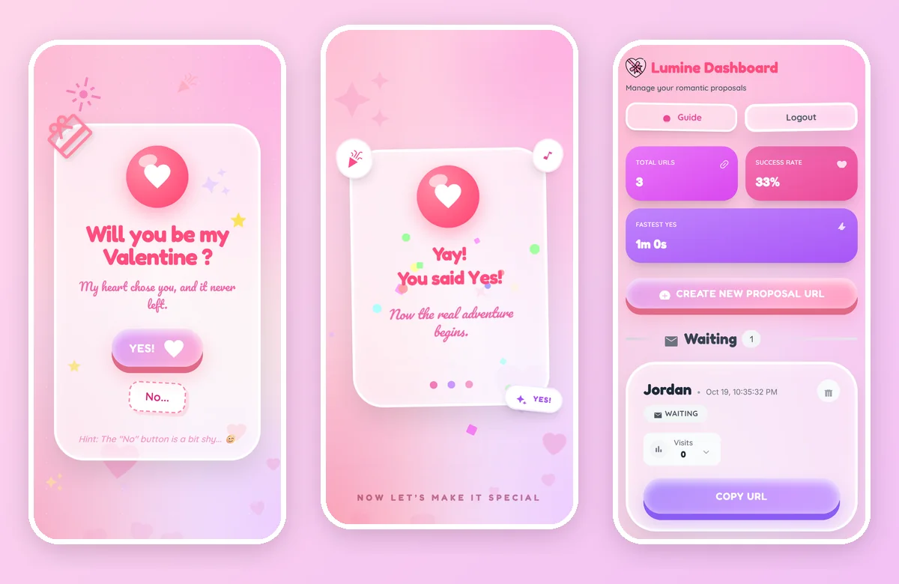
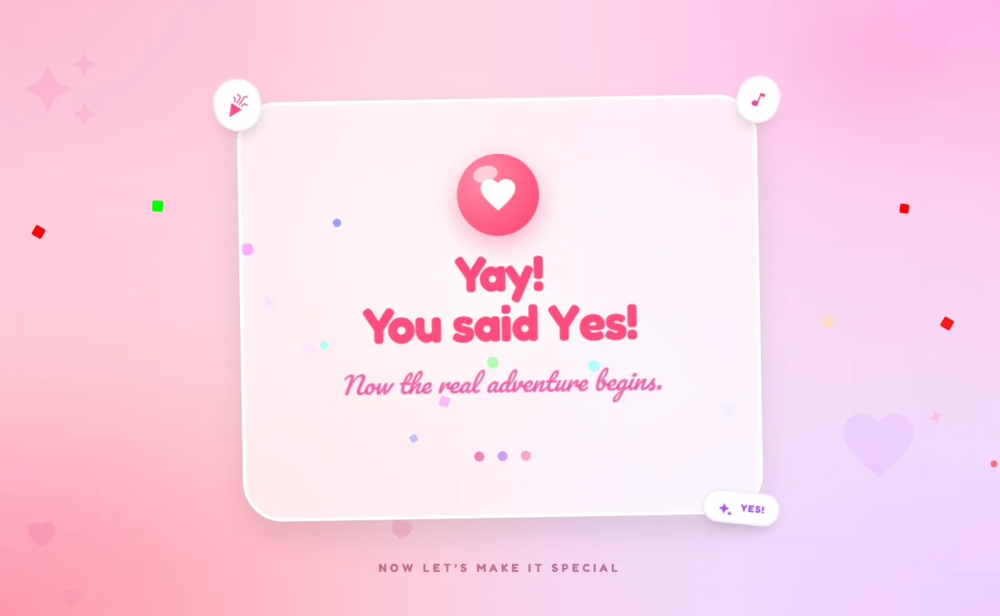
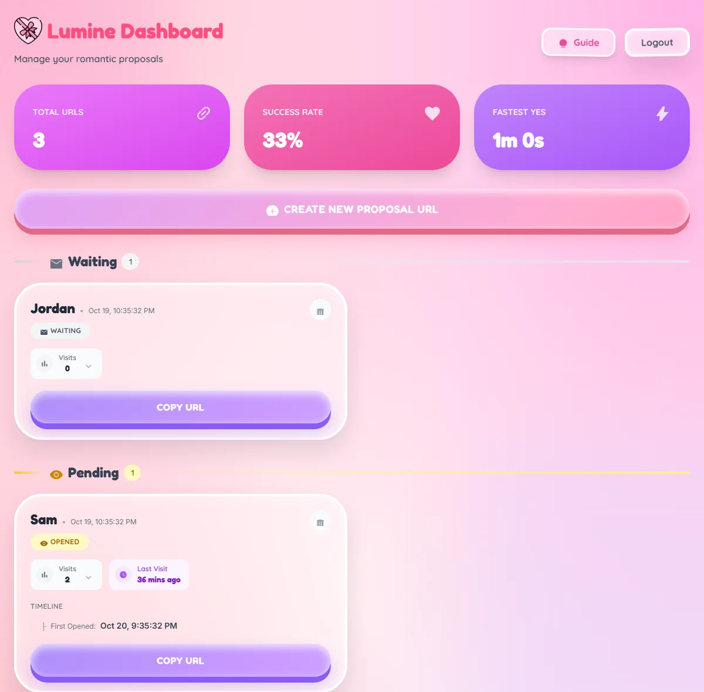

# 💝 Lumine - Digital Proposal Experience

**Ask "Will you be my Valentine?" with a link they will never forget.** Lumine turns a proposal into a playful,
interactive moment - and tells you the second they open it and how long it took them to say yes.

[](https://opensource.org/licenses/MIT)
[](https://reactjs.org/)
[](https://vitejs.dev/)
[](https://tailwindcss.com/)
[](https://supabase.com/)


**[🌐 Live demo](https://lumine-eta.vercel.app)** - sign up, create a link, and open it on your phone.

<p align="center">
  
</p>

---

## 🎥 What This Does

```text
💌 Create Link → 🔗 Send to Partner → 💖 Interactive Proposal → 🥂 Celebration & Stats
```

**For the sender:** a dashboard to create links and watch real-time stats - views, "No" clicks, and the time it took to say "Yes".

**For the recipient:** a beautiful, animated page where the "No" button jumps to a new spot every time it is clicked
(and shrinks the more it is pressed) until they say "Yes!"

## 📸 Screenshots

<p align="center">
  
</p>

<table>
  <tr>
    <td width="50%"><br><sub><b>The celebration</b> - confetti, music, and a heart you can press and hold.</sub></td>
    <td width="50%"><br><sub><b>The dashboard</b> - links grouped as Waiting / Pending / Yes, with live stats.</sub></td>
  </tr>
</table>

---

## ✨ Features

**The proposal**
- 💌 A "No" button that dodges, shrinks and teases; a "Yes" that triggers a celebration.
- 🎵 Background music on the celebration page with a mute button (browsers that block autoplay get a one-tap fix; the clip plays once).
- 🖱️ A heart cursor that becomes a pointing glove over buttons, with a short sparkly trail - aligned to the real click point, off on touch devices.
- 🎨 Frosted-glass cards, pastel gradients and bubbly animations, with one consistent icon set (Material Symbols) and colour theme everywhere.

**The dashboard**
- 📊 Real-time stats: when each link was opened, every visit, "No" clicks, and time to "Yes".
- 🔐 Accounts via Supabase Auth with email confirmation, password reset, and a real **Delete account** that removes everything.

**Under the hood**
- 📱 Responsive from 320px phones to 1920px desktops, portrait and landscape - no sideways scrolling at any size, and short (landscape) screens get a compact layout.
- ⚡ Fast: ~213 KB for the recipient's page, Lighthouse 97-100, steady 60 fps. See [Performance](#-performance).
- ♿ Accessible: zero axe-core violations on every page and dialog; keyboard-friendly (Escape closes dialogs); screen-reader-safe icons.
- 🛟 Self-healing: a daily job keeps the free Supabase plan from pausing the project - see [Keeping Supabase awake](#keeping-supabase-awake).

## 🧱 Tech Stack

| Layer | Tools |
|-------|-------|
| UI | React 18, Framer Motion (lazy-loaded), Tailwind CSS 3, Material Symbols |
| Build | Vite 7, ESLint, TypeScript type-check |
| Backend | Supabase - Postgres with row-level security, Auth, Realtime |
| Hosting | Vercel (static site + one serverless function + a daily cron) |

---

## 📁 Project Structure

```text
Lumine/
│
├── src/
│   ├── components/              # Reusable UI components (Modals, Cursor, Toast, ...)
│   ├── pages/                   # Dashboard, Proposal, Celebration, and the auth pages
│   ├── context/                 # App-wide state (current proposal step)
│   ├── hooks/                   # Shared hooks (page title, floating particles, Escape key)
│   ├── lib/                     # Supabase client, lightweight public RPC helper, config, logger, validation
│   ├── assets/                  # Cursor images (heart + glove)
│   ├── email_templates/         # HTML templates for system emails
│   └── index.css                # Global styles & Tailwind directives
│
├── api/keepalive.js             # Vercel function the daily cron calls to keep Supabase awake
├── public/                      # favicon, robots.txt, audio/, fonts/ (self-hosted fonts + icon subset)
├── scripts/update-icons.mjs     # Regenerates / verifies the icon-font subset (npm run icons / icons:check)
├── docs/screenshots/            # Images used in this README
├── supabase_schema.sql          # Database schema for a NEW project
├── supabase_upgrade.sql         # Safe-to-re-run upgrade for an EXISTING project
├── vercel.json                  # SPA rewrite, cache headers, and the daily keep-alive cron
├── .env.example                 # Template for required environment variables
└── README.md
```

---

## 📦 Requirements

| Requirement | Purpose |
|------------|---------|
| **Node.js 20.19+** (or 22.12+) | Runtime environment (required by Vite 7) |
| **npm / yarn** | Package manager |
| **Supabase Project** | Backend (Auth & Database) |

---

## 🛠️ Installation

### 1️⃣ Clone Repository

```bash
git clone https://github.com/Cl0ud-9/Lumine.git
```

Then open it in your code editor.

---

### 2️⃣ Install Dependencies

```bash
npm install
```

---

### 3️⃣ Configure Environment Variables

A `.env.example` file is already included in the project root. Just copy it and fill in your credentials:

```bash
cp .env.example .env
```

Then open `.env` and replace the placeholders with your actual Supabase credentials:

```env
VITE_SUPABASE_URL=your_project_url_here
VITE_SUPABASE_ANON_KEY=your_anon_key_here
```

You can find both values in your [Supabase Dashboard](https://supabase.com/dashboard) → **Project Settings → API**.

---

### 4️⃣ Set Up Database

**New project:** run the contents of `supabase_schema.sql` in your Supabase SQL Editor to create the
tables, policies and functions.

That includes:
- `delete_my_account()` - powers **Delete Forever** on the dashboard (it removes the auth user itself, not just their links);
- realtime on `invites`, so new visits and "Yes" answers show up live;
- `append_capped()` - keeps only the newest 200 visit timestamps (and 50 "Yes" timestamps) per link, so a link that is
  opened thousands of times can't bloat its row. The **Visits** counter is always the exact total.

**Project you already set up earlier?** Do *not* re-run `supabase_schema.sql` (the tables already exist,
so it would error). Run `supabase_upgrade.sql` instead - it only replaces functions and enables realtime, never
touches your data, and is safe to run as many times as you like. Re-run it whenever the repo gains new database
functions (it also trims any link whose history is already over the cap the next time it is visited). Until
`delete_my_account()` exists, the dashboard falls back to deleting only the user's links before signing them out.

---

### 5️⃣ Configure Email (Auth SMTP)

Supabase's **built-in email sender is not meant for production use** - it's rate-limited to a
handful of emails per hour and sends from a shared, often spam-flagged address. Signup
confirmation and password-reset emails will be unreliable (or silently never arrive) until you
connect a real provider:

1. Sign up with an SMTP provider (e.g. [Resend](https://resend.com), [Postmark](https://postmarkapp.com), or [SendGrid](https://sendgrid.com) - all have usable free tiers).
2. In your Supabase Dashboard, go to **Project Settings → Authentication → SMTP Settings** and enable **Custom SMTP** with that provider's credentials.
3. While you're there, go to **Authentication → Email Templates** and paste in the HTML from `src/email_templates/lumine_confirm_signup.html` and `src/email_templates/lumine_password_reset.html` for the "Confirm signup" and "Reset password" templates respectively.

Skipping this step is fine for quick local testing (Supabase's default sender still works for a
couple of emails), but don't rely on it for anything you're actually sending to someone.

---

### 6️⃣ Run Locally

```bash
npm run dev
```

The app root (`/`) is the **recipient-facing proposal page** - it expects a `?token=...` query
string from a link generated in the dashboard, so opening it directly with nothing after it will
just show an "Invalid Link" screen. To actually use the app locally:

1. Visit `http://localhost:5173/auth/register` and create an account.
2. Log in, then create a proposal URL from the Dashboard.
3. Open the **generated link** (something like `http://localhost:5173/?token=...`) to see the actual proposal flow.

---

## 🔧 Deployment

Ready to share the love with the world?

1. Build the project:
   ```bash
   npm run build
   ```
2. Deploy to Vercel (recommended - the daily keep-alive below needs it) or any static host (Netlify, ...).
3. Ensure your production environment variables are set in your hosting dashboard.
4. In your Supabase Dashboard go to **Authentication → URL Configuration** and set **Site URL** to your
   deployed address (e.g. `https://your-app.vercel.app`), and add `https://your-app.vercel.app/**` to
   **Redirect URLs**. Without this, confirmation and password-reset emails can link back to the wrong
   address (often `localhost`).

The app is a single-page app, so every path (`/auth/verify`, `/admin/analytics`, ...) must serve
`index.html`. `vercel.json` already does this on Vercel; on Netlify or similar hosts add an equivalent
rewrite rule (e.g. a `_redirects` file containing `/* /index.html 200`), otherwise refreshing or opening
a deep link returns a 404.

### Keeping Supabase awake

On Supabase's **free plan a project pauses after about a week without activity**, which takes the whole app offline
until it is restored by hand. To prevent that, `vercel.json` schedules a daily cron (06:00 UTC) that calls
`/api/keepalive` ([`api/keepalive.js`](api/keepalive.js)). The function runs one harmless read-only query - the same
`check_invite_exists` call the recipient page uses, with a token that can never exist - so nothing is written.

- **No setup needed on Vercel.** It reuses the `VITE_SUPABASE_URL` / `VITE_SUPABASE_ANON_KEY` you already set for the build.
- **Check it works:** open `https://your-app.vercel.app/api/keepalive` - you should see `{"ok":true,"ms":...}`.
  If the database can't be reached it returns HTTP 502, which shows up as a failed run under
  **Vercel → your project → Settings → Cron Jobs / Logs**, so a problem is noticed instead of silently ignored.
- **Optional hardening:** set a `CRON_SECRET` environment variable in Vercel. Vercel then sends it with every cron call
  and the endpoint rejects anything else.
- Vercel's free (Hobby) plan allows daily crons, which is all this needs. Not on Vercel? Call that same URL from any
  scheduler (GitHub Actions, cron-job.org, ...) at least every few days.
- If a project does get paused anyway: Supabase dashboard → **Restore project**.

---

## ⚡ Performance

Measured with Lighthouse 13 (mobile = its throttled "slow 4G + 4x CPU" profile) and a real-browser frame-pacing script.
*Before* numbers are from before the optimisation pass; *after* numbers are from the live site where possible (the
proposal page was measured on a local production build, because every real visit is counted on the dashboard).

| Page | Perf mobile | LCP mobile | Perf desktop | Accessibility | Transfer |
|------|:-----------:|:----------:|:------------:|:-------------:|:--------:|
| Login | 74 → **98** | 5.9 s → **2.4 s** | 95 → **100** | 88 → **100** | 808 KB → **280 KB** |
| Sign up | 72 → **97** | 5.9 s → **2.4 s** | 94 → **100** | 88 → **100** | 809 KB → **280 KB** |
| Proposal (what the recipient opens) | 77 → **97** | 5.2 s → **2.4 s** | 98 → **100** | 100 | 728 KB → **213 KB** |

Layout shift is 0.000 on every page. Frame rate went from 41-52 fps to a steady **60 fps** on the proposal and
celebration pages, and the Guide dialog from 26 to 60 fps.

What made the difference:

- **Icon font 480 KB → 6 KB.** Only the ~35 glyphs the app uses are shipped (see [Fonts & icons](#-fonts--icons)).
- **Self-hosted, preloaded fonts** instead of a third-party stylesheet that blocked first paint.
- **The recipient's page no longer loads the Supabase client.** It makes 3 tiny RPC calls with a plain `fetch`
  (`src/lib/publicRpc.js`); `@supabase/supabase-js` (~45 KB gzipped) only loads for login / dashboard.
- **Framer Motion loads lazily** (`<LazyMotion>` + `m.*` components) and the celebration screen is its own chunk.
- **No live backdrop blur where things move behind it.** `backdrop-filter` re-blurs everything behind an element
  on every frame it changes; on the proposal / celebration cards (hearts and confetti float behind them) and on
  the modal overlays that alone cost 10-35 fps. Those use a denser flat fill instead (`.sticker-card--flat`).
- **`dvh` units** so full-screen pages don't scroll a few pixels on phones because of the browser's address bar.

To re-measure: `npm run build && npm run preview`, then run Lighthouse from Chrome DevTools (use an
incognito window). `ANALYZE=1 npm run build` writes a bundle-size report to `stats.html`.

---

## 🔤 Fonts & icons

Everything is served from `/public/fonts` - no Google Fonts requests. The five text fonts are the Latin
subsets of Inter, Fredoka, Pacifico, Plus Jakarta Sans and Quicksand (declared in `src/index.css`).

Icons use **Material Symbols Outlined**, but only a *subset* font containing the icons the code uses. That
keeps it at ~6 KB, with one catch: **an icon that is not in the subset renders as plain text** (you would see the
word "lightbulb"). To make that impossible to forget:

```bash
npm run icons         # scan src/, download a fresh subset from Google Fonts, update the references
npm run icons:check   # fails if the code uses an icon the font doesn't contain (also part of `npm run lint`)
```

**Adding a new icon:** use it in JSX as usual (`<span className="material-symbols-outlined">rocket_launch</span>`),
run `npm run icons`, and commit the changed files in `public/fonts`, `src/index.css` and `index.html`. The font
file name contains a content hash, so browsers that cached the old font fetch the new one automatically.

---

## 🧰 Development notes

A few things that look odd but are deliberate - each one fixed a real bug:

- **Use `m.div`, not `motion.div`.** Animations are lazy-loaded through `<LazyMotion strict>`; a stray
  `motion.*` import throws in development. The feature set (`src/lib/motionFeatures.js`) is `domAnimation`;
  switch it to `domMax` if you ever add `layout` / `layoutId` / `drag`.
- **`.sticker-card--flat` must stay `transform-style: flat`.** The proposal card tilts with the mouse using
  `preserve-3d`. A `backdrop-filter` silently forces flat rendering; removing it without forcing flat made
  Chromium mis-hit-test parts of the Yes button.
- **Dialogs: panel `overflow-hidden`, content in `.modal-scroll`.** Putting `overflow-y: auto` on the panel
  itself made decorative blobs hanging past its edge produce a sideways scrollbar.
- **Short screens (landscape phones):** layouts shrink with the arbitrary variant
  `[@media(max-height:500px)]:...`, so the whole proposal fits without scrolling.
- **The "No" button** is positioned *after* its new label renders (a layout effect) and accounts for its random
  tilt, so it can never land on top of "Yes". A "Yes" click within 450 ms of a "No" is ignored, because mashing
  "No" on a phone otherwise sent stray taps to "Yes" while the button was still sliding.
- **Visit history is capped, the counter is not.** `append_capped()` (in the SQL files) keeps the newest 200 visit
  timestamps and 50 "Yes" timestamps per link; `total_visits` is a separate exact counter, and the dashboard says
  "Showing the latest N of M visits" when the list was trimmed.

---

## 🐛 Troubleshooting

| Issue | Solution |
|------|----------|
| Login fails | Check Supabase URL/Key in `.env` |
| Styles broken | Ensure Tailwind is running (`npm run dev`) |
| Icons show as words (e.g. "lightbulb") | The icon isn't in the font subset - run `npm run icons` (see [Fonts & icons](#-fonts--icons)) |
| A new `motion.div` throws "strict mode" | Use `m.div` - animations are lazy-loaded (see [Development notes](#-development-notes)) |
| Animations laggy | Enable hardware acceleration (browser settings) |
| Confirmation/reset email never arrives | Configure custom SMTP - see [step 5](#5️⃣-configure-email-auth-smtp) above. Supabase's default sender is rate-limited and unreliable. |
| Everything suddenly fails / the app can't reach the database | The free Supabase project was paused. Click **Restore project** in the Supabase dashboard, then check [Keeping Supabase awake](#keeping-supabase-awake) so it doesn't happen again. |
| `/api/keepalive` returns 502 or 500 | 502: the database is unreachable (paused? restore it). 500: `VITE_SUPABASE_URL` / `VITE_SUPABASE_ANON_KEY` aren't set for that Vercel deployment. |
| `npm install` / `npm run build` errors about the Node version | Use Node 20.19+ (or 22.12+) - see Requirements |
| "Delete Forever" removes links but the account still exists | Your database is missing `delete_my_account()` - run `supabase_upgrade.sql` (step 4) |
| A link's visit list is shorter than its Visits counter | Expected: only the newest 200 visits are listed, the counter is the exact total |
| App shows a blank/error page on startup | You're likely missing `VITE_SUPABASE_URL`/`VITE_SUPABASE_ANON_KEY` in `.env` - the app now fails fast with a clear console error instead of silently breaking later |

---

## 📜 Acknowledgements

- [React](https://reactjs.org/)
- [Framer Motion](https://www.framer.com/motion/)
- [Tailwind CSS](https://tailwindcss.com/)
- [Supabase](https://supabase.com/)
- [Material Symbols](https://fonts.google.com/icons)

---

## ⚖️ License

Licensed under the **MIT License**.

---

**Made with ❤️ for the ones who ask**
